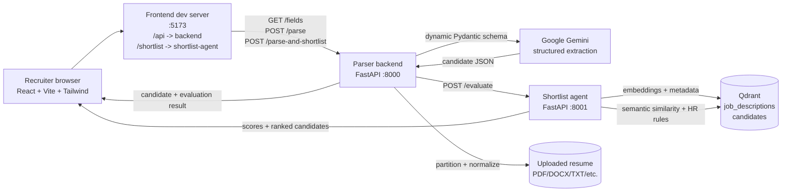

# System architecture

## Services

| Service | Container port | Host URL in the default Compose setup | Responsibility |
| --- | ---: | --- | --- |
| Frontend | 5173 | http://localhost:5173 | Recruiter UI and reverse proxy |
| Parser backend | 8000 | http://localhost:8000 | Resume parsing and Gemini extraction |
| Shortlist agent | 8001 | http://localhost:8001 | Job storage, candidate evaluation, ranking |
| Qdrant | 6333/6334 | Internal only (`qdrant:6333`) | Vector storage and similarity search |

Qdrant is intentionally not published to host ports because the shortlist agent
uses the Compose network and host port 6333 may already be used by another
Qdrant instance.

## API endpoints

Parser backend (`http://localhost:8000`):

- `GET /health` — service/provider health.
- `GET /fields` — available extraction fields.
- `POST /parse` — multipart form with `file` and JSON-string `profile` fields.
- `POST /parse-and-shortlist` — multipart form with `file`, `profile`, `job_id`,
  and `save_to_pool`; parses the resume and delegates evaluation to the
  shortlist agent.

Shortlist agent (`http://localhost:8001`, or through the UI proxy at
`http://localhost:5173/shortlist`):

- `GET /health`
- `GET /jobs`
- `POST /jobs`
- `POST /candidates`
- `POST /evaluate`
- `GET /jobs/{job_id}/shortlist?limit=10`

### Resume-to-shortlist pipeline

1. The browser sends the resume and extraction profile to
   `POST /parse-and-shortlist`.
2. The parser extracts structured candidate data with Gemini.
3. The parser calls the shortlist agent's `POST /evaluate` endpoint over the
   internal Compose network.
4. The shortlist agent loads the job vector and rules from Qdrant, calculates
   semantic and rule-based scores, and optionally saves the candidate.
5. The parser returns both `parse` and `evaluation` in one response.

Extraction-only clients can continue using `POST /parse`, while clients that
already have structured candidate data can call the shortlist agent directly.

### HR-configurable rules

Each job can define:

- Required skills, which are hard requirements.
- Preferred skills with weights from 1 to 10.
- Minimum years of experience.
- Minimum degree and preferred location.
- Shortlist and Hold score thresholds from 0 to 1.

Candidates that fail a hard requirement are rejected even if their semantic
similarity score is high.

The frontend reaches parser routes through `/api`, so for example the browser
calls `GET http://localhost:5173/api/fields` and Vite forwards it to the parser.
